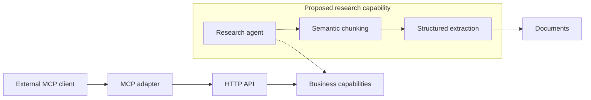

# 4. Research Intelligence, Model Context Protocol (MCP), and Agent Architecture

Tracking: [#1 Plan staged Research Intelligence and MCP capabilities](https://github.com/Jadeiin/quirebase/issues/1)

## Context

Scholarly workflows increasingly leverage Large Language Models (LLMs) and autonomous agents for literature review, semantic synthesis, equation/table extraction, and automated annotation. However, integrating AI must not violate the core architectural invariants established in ADR-0001 (Deferred Integrations & Ports/Adapters) and ADR-0002 (Modular Monolith Organization by Business Capabilities).

Specifically:
1. Core business modules (`library`, `documents`, `access`, `projects`) must remain pure, decoupled from vendor LLM SDKs and prompt engineering logic.
2. External AI tools (such as Claude Desktop, Cursor, IDE plugins, CLI agents) require a standardized protocol to inspect libraries, query metadata, and create annotations.
3. PDF text extraction for research papers requires structural fidelity—preserving LaTeX mathematical formulas, markdown tables, section hierarchies, and figure captions.

## Decision: MCP protocol adapter

An inbound protocol adapter built with FastMCP 4 over the official MCP SDK. Remote access uses
stateless Streamable HTTP; Quirebase mounts it at `/mcp/` in the FastAPI service.

The typed FastAPI `/api/v1` contract is the canonical application protocol. MCP tools are a curated
OpenAPI-derived projection of those routes, executed through an in-process ASGI client. The adapter
keeps a fixed operation allowlist and supplies MCP-specific names, descriptions and safety
annotations; it does not duplicate application orchestration or response DTOs. API Tokens are
verified by the MCP transport and again by the API dependency. A request-local trusted context
preserves MCP tool and token provenance for Audit Events without accepting client-controlled
provenance headers.

The [tool policy](../../src/quirebase/mcp/policy.py) owns the fixed allowlist. The following
examples cover ordinary User research workflows:

| Capability | Tool examples | Boundary |
| --- | --- | --- |
| Workspace discovery | `workspaces.get_workspaces`, `workspaces.get_user_workspace`, `workspaces.get_workspace_members` | Select an accessible Workspace before research operations; membership directory reads grant no governance mutations |
| Import | `imports.stage_identifiers_import`, `imports.import_batches`, `imports.import_batch`, `imports.commit_staged_import`, `imports.delete_import` | Identifier staging is an open-world write and creates no Items; confirmation follows explicit User review, preserves preview-version checks and replays the committed receipt; deleting a receipt preserves Items |
| Library | `library.search_items`, `library.get_library_item`, `library.create_library_item`, `library.update_library_item`, `items.delete_library_item`, `tools.duplicate_items` | Reads use the API pagination contract where available; writes reuse Workspace resource-action decisions and optimistic version checks; duplicate review never implies automatic merge |
| Projects | `projects.list_projects`, `projects.get_project`, `projects.create_user_project`, `projects.update_project`, `projects.join_project_api`, `projects.leave_project_api`, lifecycle, Item and participant tools | Open Project self-participation is separate from managed participant governance; Project Items use the Library Search project filter |
| Documents | `documents.list_documents` | Returns revision and attachment metadata, never object keys, bytes or extracted text |
| Annotations | `annotations.list_annotations`, `annotations.create_annotation`, `annotations.update_annotation`, `annotations.delete_annotation`, `annotations.restore_annotation`, `annotations.restore_reply` | Lists may span File Revisions and include Replies; restoration retains authorship, version checks and the undo window |
| Organization | `items.item_organize`, `library.list_tags`, Item Tag tools, `tools.rename_user_tag`, `tools.merge_user_tags`, `tools.delete_user_tag`, Item/Project Discussion tools | Inspect assignments before and after changes; Tag deletion/merge is distinct from removing one Item assignment |
| Discovery and citation | `discovery.discovery_providers`, `discovery.search_discovery`, `tools.citation_styles`, `library.format_item_citation` | Query available choices before use; external Discovery and Identifier Lookup never receive the inbound API Token |

The initial tool list contains `search_tools` and `call_tool`; BM25 tool discovery returns at most
five matches per query. Server instructions direct clients to translate search queries into English,
choose a Workspace explicitly and review Import previews before confirmation. This guidance does
not replace the business operation's authorization or validation.

The allowlist deliberately omits administrative and operational capabilities. It also omits file
upload/download and extracted full text: the current full text is an unstructured plain-text field
and needs a bounded structured-document interface before it becomes an MCP capability. Resources
and prompts are not required for this tool-oriented slice. API Tokens do not carry separate
read/write or per-tool scopes; adding a tool changes the server allowlist for every valid token and
therefore requires its own authorization and behaviour review.

Every generated tool forwards the already verified Bearer credential only to the in-process API
client. The API verifies it again, derives the User and invokes the existing business Interface,
which continues to apply the same System/Workspace resource-action policy, canonical relation
facts, transaction rules and Audit Events. Tool input never selects the authorization subject.

Programmatic Adapters bind protocol, operation and API Token/client identity through the Audit
Module interface. A successful data-changing operation records one business Audit Event enriched
with that invocation source; it does not also record a protocol event. Security-sensitive reads
such as Discovery retain their dedicated business Audit Event, while ordinary successful reads do
not create persistent per-call records. MCP validation failures, authorization failures and other
protocol outcomes likewise do not create Audit Events; operational diagnostics for those paths
belong in redacted logs and metrics rather than the immutable business audit history. Tool
arguments, bearer credentials and result content are never added to Audit Events.

For Streamable HTTP, the Accounts Module issues revocable, expiring API Tokens and stores only their
hashes. MCP accepts them only as `Authorization: Bearer` credentials; browser Login Sessions and
CSRF tokens are not MCP credentials, query-string tokens are rejected, and an inbound token is
never passed to an upstream Provider. The raw token is shown only once at creation. This deliberately
does not implement MCP OAuth authorization discovery: deployment and client configuration are
simpler, at the cost of interactive OAuth acquisition, delegated clients and step-up scopes.

## Consequences

- Core library and storage operations remain 100% independent of AI dependencies.
- External agent ecosystems can read and write to Quirebase without custom integration code.
- Protocol and transport behaviour follows FastMCP and the official MCP SDK rather than a
  Quirebase JSON-RPC implementation.
- MCP and HTTP cannot drift into parallel orchestration paths because both execute the same API
  operations and response contracts.
- API Tokens expire, can be revoked, and immediately lose access when their User is deactivated.
- Tool availability is server-wide; User- and object-level authorization remains authoritative.

## Research directions (proposed)

Structured extraction, semantic chunking and an internal research agent remain research work in
[#1](https://github.com/Jadeiin/quirebase/issues/1), separate from the implemented MCP adapter.
The candidate design considers a dedicated capability with:

- **Structural Extraction**: PyMuPDF4LLM or structured PyMuPDF extraction transforming a File
  Revision into Markdown, preserving LaTeX formulae, tables, section structure and figure captions.
- **Semantic Chunking**: Header-aware document chunks for retrieval-augmented generation.
- **Research Agent**: Pydantic AI with typed outputs such as ItemSummary, LiteratureReview and
  SynthesisOutput, calling existing capability interfaces.

These are options to evaluate, rather than selected dependencies or implemented interfaces. The
cost of structural extraction, model execution and local/cloud configuration belongs in that
capability; Documents retains File Revision ownership. The intended separation is:

