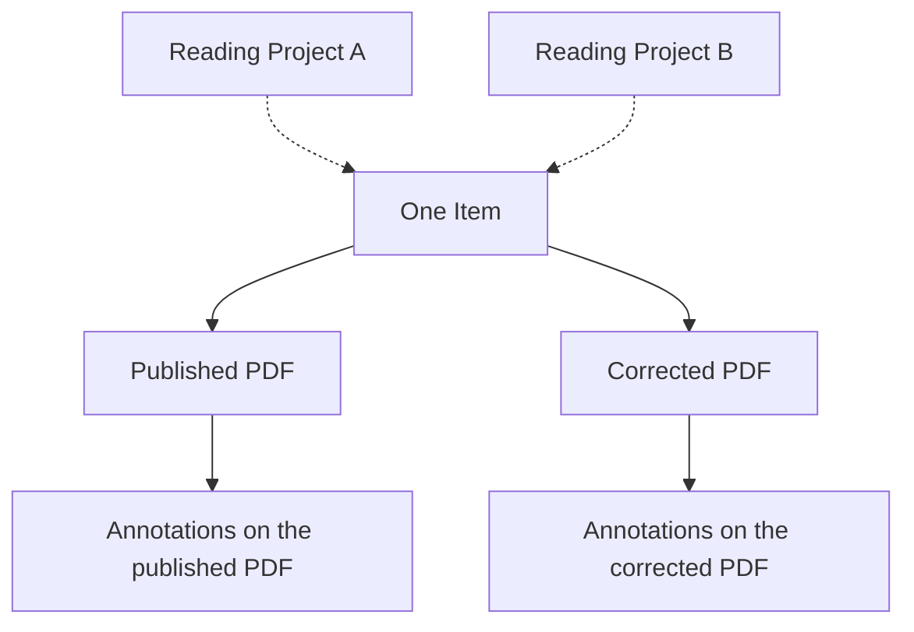

Suppose you keep a journal article in a Workspace, upload its published PDF, and later add a corrected
PDF. You have **one Item**, with **two File Revisions**. A private note on the first PDF is saved
with that revision.

If you add this Item to two Projects, both Projects refer to the same Workspace record. Each can
hold its own Project Annotations and Discussions. Updating the Item metadata updates that shared
record, while private marks and each Project's reading context have their own visibility.

## Match the term to the thing you are editing

| Term | What it represents | Example |
| --- | --- | --- |
| Item | A bibliographic record in one Workspace | The journal article in Library |
| Work | The Item's Commonmeta bibliographic value | Title, type, identifiers, Contributors, and dates |
| File Revision | One immutable primary PDF | Published PDF, then corrected PDF |
| Attachment | A supplementary Item file | Supporting data or a representative image |
| Annotation | A mark anchored to one page of one revision | A highlight on page 3 of the published PDF |
| Annotation Reply | A response inheriting an Annotation's visibility | A colleague's reply to a Project highlight |
| Tag | A Workspace classification explicitly assigned to Items | `Methods` or `To read` |
| Project | A working set inside the Workspace | A reading group using some of its Items |
| Candidate Record | Metadata not yet committed to Library | A record shown in an Import preview |
| Import Batch | Sources, candidates, diagnostics, and a retained confirmation result | The batch prepared from a bibliography |

A Contributor is a person or organization credited on the reference. Names and credit order are
saved with each Work.

## Search, prepare, and confirm have different results

| Action | Where it looks or writes | Result |
| --- | --- | --- |
| Library Search | Saved Workspace metadata and extracted PDF text | Matching saved Items |
| Discovery | External scholarly Providers | Search results ready for import |
| Identifier Lookup / import preparation | Provider metadata or uploaded source data | Candidates and diagnostics for review |
| Import confirmation | The selected Workspace | Saved Items from the prepared batch and basic-PDF selection |
| Manual creation | The selected Workspace | A saved Item when you choose **Create Item** |

Import history records the created Item IDs so you can find a batch's references. Receipts follow
the installation's retention policy; Items and files remain in Library.

## Identity and lifetime

An Item has its own UUID and Workspace lineage. A DOI identifies the bibliographic Work; several
Items may carry the same DOI, so duplicate suggestions require review. A Citation Key is an editable
name for citation output.

Save an Item's bibliographic metadata first, then add PDFs and Attachments. Each PDF revision keeps
its own pages and Annotations. Deleting a revision removes its marks and thumbnail; deleting a
Project association removes its Project marks and Replies; deleting an Item removes its files and
related content.

Continue with [Workspace access](/concepts/workspaces-and-projects/) or follow the
[first-reference walkthrough](/getting-started/quickstart/).
