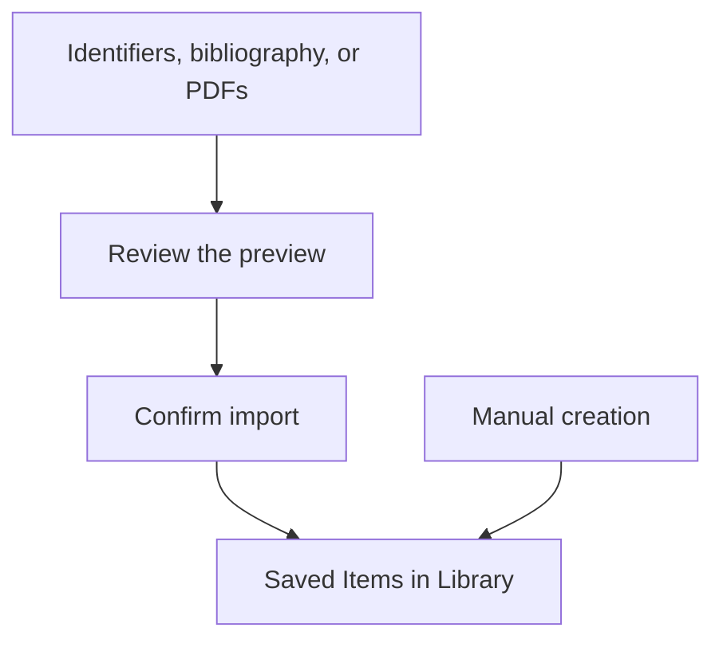

Open the destination Workspace, then **Import**. You need permission to create Items. If you are
looking for references by topic or title, begin with [Discovery](/guides/discovery/).

## Choose an input method

| Import tab | Use it when | Action that creates Items |
| --- | --- | --- |
| Identifiers | You have DOI, PMID, arXiv, ISBN, or OpenAlex identifiers | Confirm the prepared preview |
| Bibliography | You have BibTeX, RIS, CSL-JSON, or Commonmeta data | Confirm the prepared preview |
| PDFs | You have up to 50 PDF files and want metadata candidates | Confirm the preview, including any basic PDFs you explicitly select |
| Manual creation | You want to enter one record yourself | Choose **Create Item** in the editor |

The first three methods create an **Import Batch** for review. Manual creation saves an Item directly.



## Import from identifiers

1. Choose **Identifiers** and paste up to 50 inputs, one per line. For example:

   ```text
   10.1073/pnas.92.6.2288
   https://pubmed.ncbi.nlm.nih.gov/11607519/
   arXiv:2304.08030
   ISBN:0674016394
   ```

2. Keep **Data source → Auto detect**, or select a Provider that supports the input.
3. Choose **Preview metadata**, then follow the preview checks below.

Prefix ISBN-10 with `ISBN:`. To search PMC articles, use [Discovery](/guides/discovery/).

## Import a bibliography

1. Choose **Bibliography**.
2. Use **Choose file**, or paste the data into **Or paste bibliography data**. Remove a chosen file
   before switching to pasted input.
3. Leave **File format** on **Auto detect**, unless you need to choose the format explicitly.
4. Choose **Preview bibliography**.

Export BibTeX, RIS, CSL-JSON, or Commonmeta from your reference manager. Use UTF-8 encoding and a
file size of at most 5 MiB.

## Import PDFs

1. Choose **PDFs**, then drop files into the picker or choose them. You can add up to 50 files.
2. Choose **Preview import**. A worker prepares candidates; leave the retained preview available
   while this runs.
3. Review the identified records and the separate **PDFs without metadata** section.
4. Explicitly check each basic PDF candidate you want to keep, or use **Select all** in that section.

A selected basic candidate keeps the file with minimal metadata for editing after import. See
[file management](/guides/files/) for preparing PDFs.

## Review the preview and commit once

Check the title, Contributors, Reference Type, identifiers, publication details, and **Import issues**.
Provider metadata can be incomplete.

| Preview content | What confirmation does |
| --- | --- |
| Identified records | Imports the prepared identified records together |
| Basic PDFs without metadata | Imports only the basic PDF candidates you explicitly selected |
| Diagnostics or failures | Explains skipped or unavailable inputs; successful candidates remain usable |

To adjust the identified records, use **Discard**, correct the inputs, and prepare a new batch.
For temporary Provider failures, use **Retry metadata** when offered.

When the preview is ready, review the count on **Import … records** and confirm. After **Import
completed**, use **View imported Items**. This opens Library filtered to that batch's imported Items;
clear the filter when you want the rest of your Library. File processing and Tag Recommendations may
continue after confirmation.

## Return later or recover an uncertain result

Use **Import history** to reopen a retained batch. If the application cannot confirm whether the
import completed, choose **Check import status** to see the result.

**Delete import record** on a committed batch preserves its Items and files, but removes the receipt
and its batch filter. Batch history follows the installation's retention policy.
